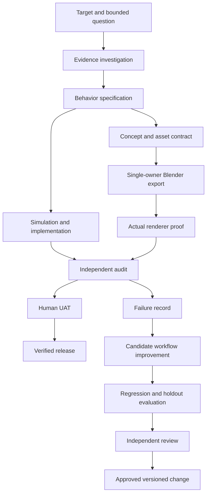

# Orchestration and run harness

The coordinator uses the host's actual agent tools or runs roles sequentially. This package's Python harness validates the plan and emits tickets; it does not launch model calls, tools, deployments or background work.

## Ticket contract

Give each worker objective, prerequisites, raw artifacts, owned paths/resources, acceptance criteria, tool authority, output format, budget and stop condition. Do not tell an independent reviewer the desired verdict. Return actual files, checks and evidence, unresolved questions, and any out-of-scope finding.

Assign research, simulation, renderer, asset production and reviewer as roles; one person/agent may fill several sequentially. Shared contracts and package/dependency edits have one coordinator owner. At most the declared worker limit runs. File prefixes and named resources prevent conflicting assignments; scene names, exporter session and deployment project can be exclusive resources.

Scheduler output is a proposal, not a reservation. Persist actual active state before scheduling another batch. No two coordinators should write the same project manifest concurrently. This release does not implement distributed locking or persistent worker execution.

## Handoffs and review

Inventory before broad exploration; one hypothesis per experiment. Preserve target hashes and exact scope. Pin tool versions; revalidate when source or runtime changes. Use immutable evidence snapshots where available.

Reviewer inspects the exact subject revision and reruns relevant checks. New failures supersede old passes. Reviewer identity assertions are not cryptographically authenticated by this harness; an external system or human must establish who performed the review.

Pause a blocked branch, continue independent supported tasks, and do not choose another target silently. Use bounded retries and record their causes. A host tool denial is not fixed by weakening unrelated permissions or claiming a call succeeded.
